# Mod Box

[](https://github.com/LupusMalusDeviant/mod-box/actions/workflows/ci.yml)
[](LICENSE)


**One mod to manage your Claude Code mods: switch, configure and profile them in one window. It ships with my best-of selection of fifteen mods, and takes any others you add.**

Claude Code mods are small hook modules that change how Claude Code behaves and looks: a guard that stops `rm -rf` before it runs, a meter that shows when the prompt cache goes cold, a watcher that follows your CI after every push. There are a lot of good ones scattered over GitHub. The Mod Box collects them, makes them work together, and gives you one place to switch them, configure them and add more.

<!-- screenshot: the Mods tab -->
<p align="center">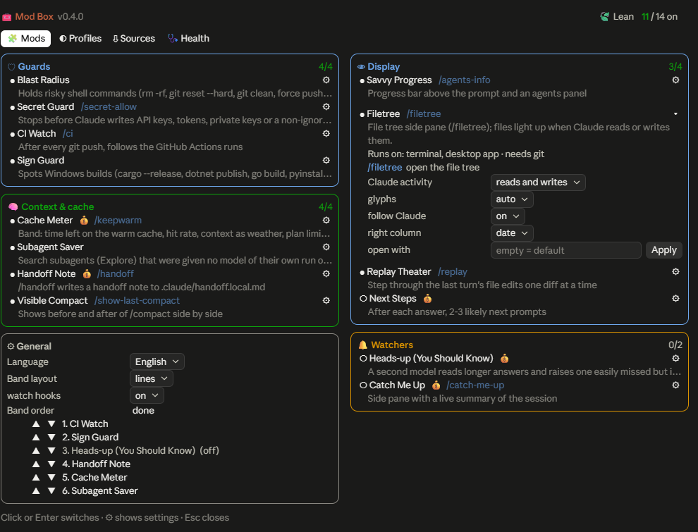</p>

**Highlights**

- **One window** (`/mod-box`): every mod as a card with a switch, its options, commands and token cost; profiles; sources; health.
- **Guards**: Blast Radius holds destructive shell commands, Secret Guard stops keys and `.env` files before they reach a file or commit, CI Watch follows every push and pull request to the end.
- **Saves money and limits**: Cache Meter shows the warm cache and plan limits and stops a send to a cold cache with its price; Subagent Saver runs search subagents on Sonnet instead of your main model; auto-compact can kick in earlier.
- **Grows with you**: import mods from any git repo or marketplace, or ask Claude to add one with the bundled `mod-box-add` skill. Profiles are rules, so new mods land in the right ones; foreign code stays off until you trust it.
- **Knows where it runs**: each mod declares surfaces, systems and tools it needs; the window warns when one would not work here.
- English and German UI.

Most of the mods are **adapted copies of other people's mods**, credited below with what was changed. The rest were written for this box.

## Install

Needs Claude Code 2.1.287 or newer. In a terminal Claude Code session:

```
/plugin install mod-box --marketplace LupusMalusDeviant/mod-box
```

Answer `y` to add the marketplace, then pick a scope. Or from a shell:

```bash
claude plugin marketplace add LupusMalusDeviant/mod-box
```

```bash
claude plugin install mod-box@mod-box
```

Then open the window with `/mod-box`. A mod installed at user scope also runs in the desktop app's Code tab.

**Update** with `claude plugin update mod-box@mod-box` and a restart of Claude. **Remove** with `claude plugin uninstall mod-box@mod-box`.

**Working on the box itself:** have Claude Code load it straight from your clone. In `~/.claude/settings.json`, under `env`, set `CLAUDE_CODE_PLUGIN_DIRS` to the folder and `CLAUDE_CODE_PLUGIN_DIR_WATCH` to `1`, then restart Claude once. After that, every saved change reloads the box by itself. The tools in `tools/` need Node.js 26. See [CONTRIBUTING.md](CONTRIBUTING.md).

## Just one mod?

The own mods and the forks with real changes are also available one by one, without the box: [**claude-mods**](https://github.com/LupusMalusDeviant/claude-mods) (Cache Meter, Subagent Saver, Secret Guard, CI Watch, Sign Guard, Handoff Note, Heads-up, and Blast Radius as a marked fork). For the other mods, use their originals; they are linked under [Credits](#credits).

## Safety

- Mods run inside your Claude Code session with the rights of a plugin: they can read and write files and run commands. Only add mods from sources you trust. Foreign mods, integrated or natively managed, start switched off and stay off in every profile until you trust them. Trust is your decision, not a sandbox.
- Looking is safe: inspecting a plugin, the Sources tab and its list of parts read files only and run nothing.
- Secrets stay in Claude Code's credential store. The box never shows, logs or reads back a sensitive option; the window only says whether it is set.
- Validation is not an audit: `claude plugin validate` proves that a plugin loads, not that it is harmless.
- Secret Guard and Blast Radius are guards, not guarantees.
- The box writes to `~/.claude/settings.json` only where you ask it to: switches and options (in `pluginConfigs`, where the desktop app does not list plugin rows in `/config`) and the auto-compact window when you set it.
- The box sends none of your data anywhere. It only fetches from git sources you add, and CI Watch talks to GitHub through your own `gh`. Mods that call a model (Next Steps, Heads-up, Catch Me Up, the handoff note, keep-warm) say so and show their token use.

## The window

**`/mod-box`** opens the window. `/mod-box profiles`, `sources` and `diag` open it on a given tab. The window speaks English by default, or German with the `language` setting.

- **Mods**: the mods as cards, one per group. ● means a mod is on, ○ means off; click a mod to switch it. ⚙ opens its description, its token cost and its options. The window has two columns when it is wide enough.
- **Profiles**: set all switches at once: *Default*, *Lean* (nothing that always costs tokens), *Guards only*, *Everything on*. Profiles are rules, not lists (see [Profiles and new mods](#profiles-and-new-mods)).
- **Sources**: connected Claude marketplaces show up here by themselves, and you can add your own git links (a marketplace, a plugin repo or a collection of mods, as `owner/repo` or a URL). The **Import** button fetches a mod with function hooks, rewrites it for the box and validates it. The imported mod starts switched off, and if validation fails, the box stays as it was. **Updates of the originals** checks the copied mods against their upstream repos (see below).

- **Health**: shows four things:
  - token use of the mods that call a model;
  - hook failures in this session;
  - an environment check (node, git, `gh` signed in, Git Bash, the signing script);
  - a **Validate** button.

  If Claude Code runs with `--debug-file ~/.claude/mod-box/debug.log`, this tab also shows the box's last error lines from that log.

Some hosts, the desktop app among them, don't list a plugin's options in `/config`. There the window builds the rows itself and writes changes to `pluginConfigs` in `~/.claude/settings.json`, which is where Claude Code keeps them.

## In the terminal

The same window runs in terminal Claude Code, as a side pane next to the conversation.

<table>
<tr><td>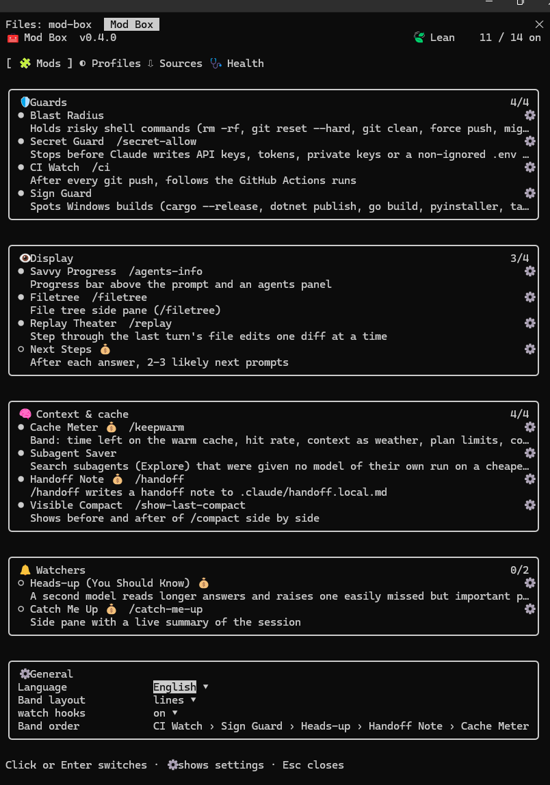</td><td>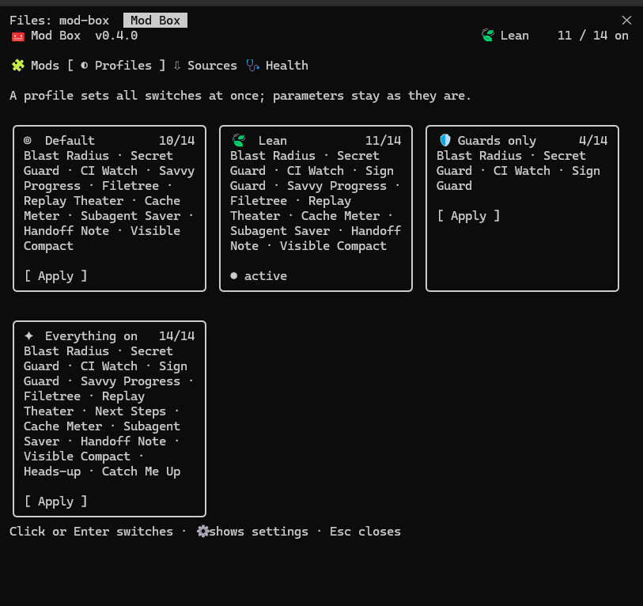</td></tr>
<tr><td>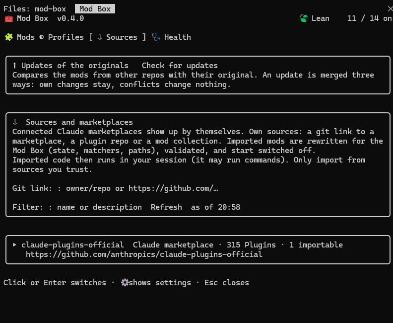</td><td>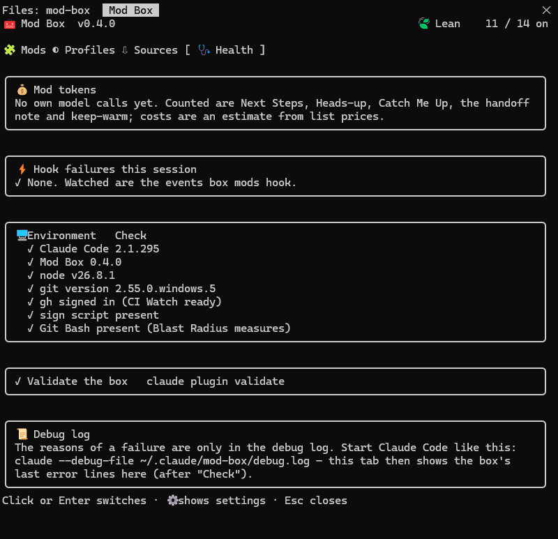</td></tr>
<tr><td colspan="2" align="center">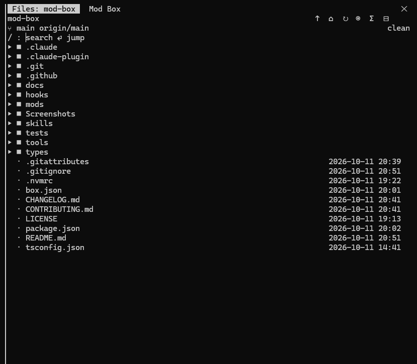</td></tr>
</table>

## The mods

| Switch | Mod | Default | What it does | Costs tokens? |
|---|---|---|---|---|
| `blastRadius` | Blast Radius | on | Holds risky shell commands (`rm -rf`, `git reset --hard`, `git clean`, force push, migrations) and shows what they would hit. | no |
| `secretGuard` | Secret Guard | on | Stops before an API key, token, private key or non-ignored `.env` file gets into a file, `git add` or a commit. Mode *block* or *warn*; exceptions via `/secret-allow`. | no |
| `ciWatch` | CI Watch | on | Follows the GitHub Actions runs after each `git push` (via `gh`) to the end. For an open pull request it watches every check and says whether the PR is ready to merge. When a run turns red, it shows the failed step's log and/or puts an analysis request into the prompt; it can also play a sound. `/ci` shows the state. | no |
| `signGuard` | Sign Guard | off | Spots Windows builds and signs the new `.exe`, `.msi` and `.msix` files with your own script (`<script> -Exe <file>`). Mode *ask* or *auto*. | no |
| `savvyProgress` | Savvy Progress | on | Progress bar and agents panel (`/agents-info`). | no |
| `filetree` | Filetree | on | File tree side pane (`/filetree`) that lights up as Claude reads and writes. Right-click a file or folder (or press `o`) for **Open with**: the default app, the editors, IDEs and browsers found on this machine (by file type), preview, show in folder, copy path; Shift+right-click copies the path. With the Codebase Map on, a **Features** tab lists its features (live marks, uses / used by, files that jump to the tree) and the blueprint actions. | no |
| `replayTheater` | Replay Theater | on | Steps through the last turn's edits (`/replay`). | no |
| `nextSteps` | Next Steps | off | Suggests 2–3 next prompts. | a Haiku call per answer |
| `cacheMeter` | Cache Meter (with Cache Tax) | on | Shows the time left on the warm cache, the hit rate, the context as weather and the plan limits, with compact and keep-warm buttons. It also stops a send to a cold cache once and names its cost, and the cost of compacting first instead. **Auto-compact at** sets Claude Code's `autoCompactWindow`: on 1M-context models Claude otherwise compacts only at about 967k tokens. | only keep-warm requests, when on |
| `subagentSaver` | Subagent Saver | on | Search subagents (Explore) that got no model of their own run on Sonnet (or Haiku) instead of inheriting the main model. An explicit model, forks, teammates and plugin agents stay untouched; the band shows how many were routed. | no |
| `handoff` | Handoff Note | on | `/handoff` writes `.claude/handoff.local.md`, and a new session offers to continue from it. | one request over the warm cache |
| `visibleCompact` | Visible Compact | on | Before/after view of `/compact` (`/show-last-compact`). | no |
| `headsUp` | Heads-up | off | Points out one easily missed but important thing in a long answer. | a Haiku call per long answer |
| `catchMeUp` | Catch Me Up | off | Live summary of the session (`/catch-me-up`). | Haiku calls after turns |
| `codebaseMap` | Codebase Map | off | Feature map from `docs/blueprints` with live highlighting of the features Claude edits, a freshness band and a `CLAUDE.md` pointer; mapper instructions with machine-checked edges load only when you ask for blueprint work (`/codebase-map`). | only blueprint runs you ask for; about 500 tokens per session for the `CLAUDE.md` pointer |

<p align="center">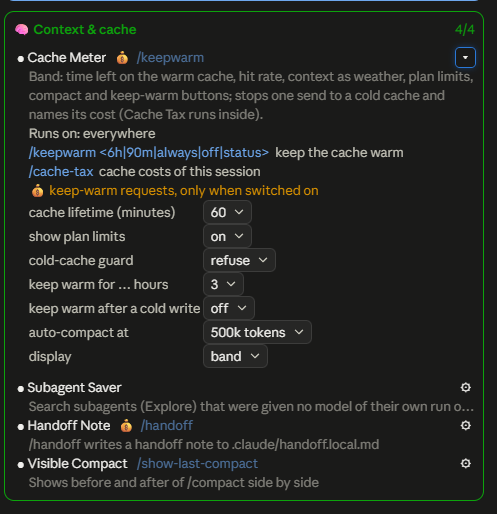</p>

## Commands

| Command | Mod | What it does |
|---|---|---|
| `/mod-box [profiles|sources|diag]` | Mod Box | opens the window, optionally on a tab |
| `/secret-allow` | Secret Guard | the exception list: last finds, project and global entries |
| `/ci` · `/ci pr <nr|url>` · `/ci stop` | CI Watch | state of the watched runs · watch a pull request · stop watching |
| `/agents-info` | Savvy Progress | agents panel |
| `/filetree` | Filetree | opens the file tree |
| `/replay` | Replay Theater | steps through the last turn's edits |
| `/keepwarm <6h|90m|always|off|status>` · `/cache-tax` | Cache Meter | keeps the cache warm · cache costs of this session |
| `/handoff` | Handoff Note | writes the handoff note |
| `/show-last-compact` | Visible Compact | before/after of the last `/compact` |
| `/catch-me-up` | Catch Me Up | live summary pane |
| `/codebase-map [create\|update [feature]\|check\|publish [feature]]` | Codebase Map | opens the feature map; with an argument, prepares the blueprint prompt (for one feature, if named) |

The window lists them too: next to each mod's name, and in full under ⚙.

## The band above the prompt

<p align="center">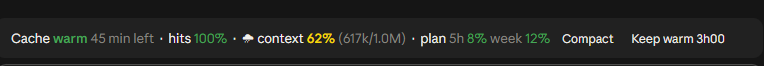<br>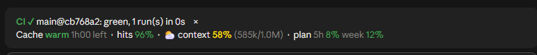</p>

CI Watch, Sign Guard, Cache Meter, Handoff Note and Heads-up hand their displays to the box, which draws them all in one band above the prompt:

- **Band layout** *compact* puts calm displays on one shared line, and urgent ones (red CI, a sign offer, a heads-up) on lines of their own. *lines* gives each display its own line.
- **Display**, per mod, chooses band, status line or off.
- **Order** is set with arrows in the Mods tab.

<p align="center">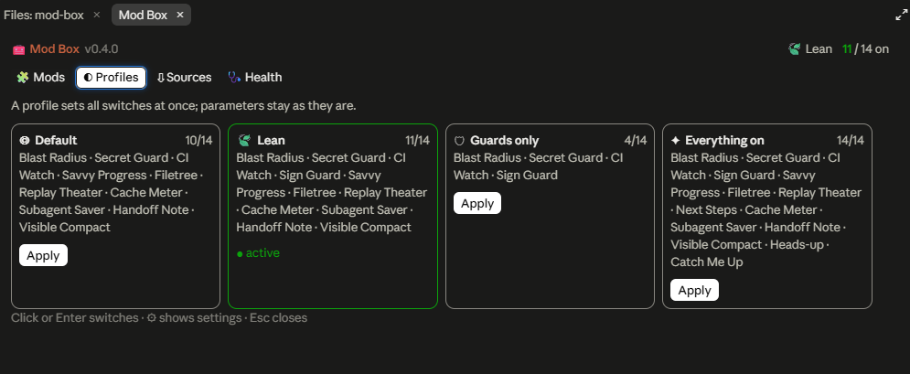</p>

## Profiles and new mods

Each mod in `box.json` carries attributes: `group` (guards, display, context, watchers), `tokens` (none, optional, always), `default`, and `compat` (see below). A profile is a rule over them: *Default* takes each mod's `default`, *Lean* takes `tokens: none | optional`, *Guards only* takes `group: guards`, *Everything on* takes all. So a new mod lands in the right profiles as soon as it is classified.

The window remembers the profile you applied last (*Default* until you apply one). At the next session start it gives every mod that is new since then the switch that profile wants, and marks it **new**. If you have changed switches by hand since, the header says *(changed)*; new mods still follow the profile.

**Foreign code waits for trust.** A mod imported from another repo starts switched off, and profiles leave it off until you trust it: **Trust** under its ⚙, or switch it on by hand once. Imported mods show 🔒 until then, 📦 after.

## Where a mod runs

Each mod declares where it works: the surfaces (terminal, desktop app, VS Code, mobile), the operating systems, and the programs it needs (`git`, `gh` signed in, Node.js, Git Bash, PowerShell, a signing script). The window compares that with the session you are in (surface, OS, and the environment check under **Health**) and puts a ⚠ with the reason next to a mod that would not, or not fully, run here. ⚙ shows the full list.

<p align="center">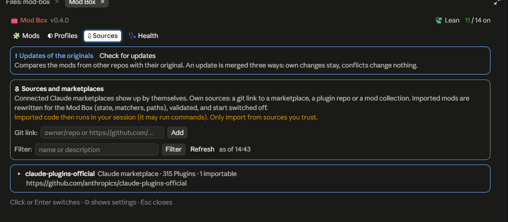</p>

## Adding mods with Claude

The box ships the skill **mod-box-add**. Ask Claude something like *"add the mod from owner/repo to the Mod Box"*, and it:

- inspects the plugin and tells you its verdict (integrated, managed natively, blocked);
- checks the license;
- imports the mod with `tools/box.mjs import`, or installs it natively with `tools/box.mjs native install`;
- reads the code and classifies it: group, tokens, where it runs, what it needs, its commands (`tools/box.mjs analyze <id>` gives a first guess to start from);
- writes the texts in English and German;
- marks the changed files and adds the credits;
- runs build, validation and tests;
- reports back in the language set in the box.

All instructions the box gives Claude (the skill, the prompts of the mods) are English. Only the language Claude answers in follows the setting.

## Any plugin: integrated, managed natively, or not supported

Not every plugin can live inside the box. Before anything changes, the box reads the plugin (nothing of it runs) and gives one of these verdicts, shown in the **Sources** tab:

- ◆ **integrated**: plain function-hook mods are copied into the box. They get a box switch, the band, profiles and box options. All hook modules, media and data files come along; option types are kept; `$.store` keys get the mod's prefix.
- 🔌 **managed natively**: plugins with skills, slash-command files, agents, MCP or LSP servers, classic hooks, dependencies, secrets or `${CLAUDE_PLUGIN_ROOT}` stay plugins of their own. The box installs them through Claude Code (`claude plugin install`), shows their parts and token cost, switches, configures, updates (with a diff) and removes them, all in the same window. Plugins without a marketplace go through the box's local marketplace. A plugin you installed yourself comes under the box with **Adopt**.
- ⛔ **blocked**: a command or tool name is already taken, or there is no license. Integration waits until that is settled; the native way often still works.
- ✗ **not supported**: for example a plugin whose hook module is missing.

The setting **Import strategy** chooses between *automatic* (integrate where nothing is lost, otherwise native) and *always native*. Trust and profiles work the same way for both kinds: a natively managed plugin is installed switched off, profiles skip it until you trust it, and once trusted it follows the profile rules by its group and token use.

The full matrix of what is handled how, before and after, the platform limits and the real plugins it was tested with are in [docs/capabilities.md](docs/capabilities.md).

## How the box is built

- **`box.json`** is the single source: mods, switches, options (English, with `_de` translations), groups, state prefixes and profiles.
- **`node tools/box.mjs build`** generates `hooks/register.ts`, the type contracts, the `userConfig` in `.claude-plugin/plugin.json` and the window's catalog. Don't edit those by hand.
- **`tools/box.mjs`** also has `export <id>... --out <folder>` (the standalone plugins of claude-mods), `catalog`, `inspect`, `import`, `reimport`, `analyze <id|dir>`, `remove`, `validate`, `updates [<id>]`, `diff <id>`, `update <id>`, `native <action>` (list, details, options, set, install, adopt, trust, untrust, enable, disable, update, uninstall, profile) and `release` (build, validate, raise the version). The window calls exactly these.

An imported mod is rewritten so the box can drive it like the others:

- its `$.state` keys move under `mod-box` with a prefix;
- each hook without a matcher gets `{}`, because a plugin may register an event only once without one;
- `$.plugin.root` and `asset:` paths point into `mods/<id>/`, and the files outside `hooks/` come along;
- literal `$.store` keys get the mod's prefix;
- every hook module is registered, behind the one switch;
- `mcp__<old>__` tool names become `mcp__mod-box__`;
- its options become box options with their types; required ones keep the mod off until they are set.

After that, `claude plugin validate` runs, and a failure rolls everything back.

### Updates of the originals

Each copied mod keeps a baseline in `mods/<id>/upstream.json`: the original repo, the commit our copy is based on, and the original files at that commit. **Check for updates** fetches the originals and compares them. **Apply** merges the changes in three ways per file (baseline, new original, our version) with `git merge-file`. The box's own rewrites are applied to both originals first, so they never count as a difference. If both sides changed the same lines, nothing is changed. A mod imported from a plain folder uses a hash of the folder as its version. Binary files are compared by hash and taken whole, or reported as a conflict if they were changed here. A failed update is rolled back.

## Checking

```bash
node tools/box.mjs build
```

```bash
claude plugin validate .
```

```bash
claude plugin test .
```

```bash
node --test tools/box.test.mjs
```

```bash
node --test tools/lifecycle.test.mjs tools/native.test.mjs
```

The last two run the whole lifecycle of foreign plugins against fixtures in `tools/fixtures/plugins`: a throwaway copy of the box, and a throwaway Claude Code profile (`CLAUDE_CONFIG_DIR`), so your own setup is never touched.

## Credits

These mods come from other repositories and **were modified for the Mod Box**. Each modified file carries a notice at the top that names the change and the original commit, and each mod keeps its original `LICENSE` in its folder.

| Mod | Original | Author | License | Changes in the box |
|---|---|---|---|---|
| Blast Radius | [anthropics/claude-code-playground](https://github.com/anthropics/claude-code-playground/tree/main/claude-code/mods/blast-radius) | Anthropic PBC | Apache-2.0 | Windows support (PowerShell wait loop, Git Bash, Windows `cd` targets); state, matchers and paths rewritten |
| Replay Theater | [anthropics/claude-code-playground](https://github.com/anthropics/claude-code-playground/tree/main/claude-code/mods/replay-theater) | Anthropic PBC | Apache-2.0 | state, matchers and paths rewritten |
| Cache Tax | [karanb192/cache-tax](https://github.com/karanb192/cache-tax) | Karan Bansal | MIT | embedded into Cache Meter (guard and auto-warm options, exported helpers, token usage) |
| Catch Me Up | [oliverow/catch-me-up](https://github.com/oliverow/catch-me-up) | Oliver Wang | MIT | language option, token usage, state rewritten |
| Codebase Map | [LupusMalusDeviant/codebase-map](https://github.com/LupusMalusDeviant/codebase-map) | Lupus Malus Deviant | MIT | state, matchers and paths rewritten |
| Filetree | [data-goblin/claude-code-filetree](https://github.com/data-goblin/claude-code-filetree) | Kurt Buhler | MIT | state, matchers and paths rewritten; Features tab for the Codebase Map added |
| Next Steps | [hamzafer/claude-code-mods](https://github.com/hamzafer/claude-code-mods/tree/main/mods/next-steps) | Hamza Zafar | MIT | language option, token usage, state rewritten |
| Savvy Progress | [JohnnyVizz/claude-kit](https://github.com/JohnnyVizz/claude-kit/tree/main/plugins/savvy-progress) | johnnyvizz | MIT | a type fix; state and tool names rewritten |
| Visible Compact | [nvsravank/visible-compact](https://github.com/nvsravank/visible-compact) | nvsravank | MIT | state, matchers and paths rewritten |

**Heads-up** is a re-implementation inspired by "You Should Know", which ships with Claude Code (`/plugin enable cc-plugin-you-should-know@builtin`). **Cache Meter, Subagent Saver, Secret Guard, CI Watch, Sign Guard, Handoff Note**, the window and the tools were written for this box.

## License

The box's own code is under the [MIT License](LICENSE). The copied mods keep their own licenses (MIT or Apache-2.0), in `mods/<id>/LICENSE`.
