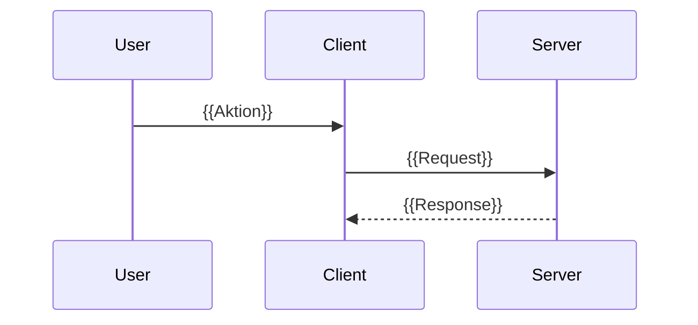

# Template: Feature-Blueprint

Vorlage für jede einzelne `docs/blueprints/<feature-slug>.md`. Die Überschriften exakt übernehmen. Leere Abschnitte weglassen, **nicht** mit "N/A" füllen.

---

# {{FEATURE_NAME}}

## Zweck

{{1-3 Sätze: Was macht dieses Feature? Warum existiert es? Was wäre anders, wenn es fehlte?}}

## Dateien

| Pfad | Rolle |
|------|-------|
| `{{pfad/zur/datei1.ts}}` | {{Was diese Datei beiträgt, 1 Satz}} |
| `{{pfad/zur/datei2.ts}}` | {{...}} |

Hinweis: Nur Source-Files aufnehmen, die zentral zum Feature gehören. Test- und Storybook-Dateien nur, wenn sie Doku-Wert haben.

## Abhängigkeiten

### Intern (andere Features dieses Repos)

Genau die ausgehenden Kanten dieses Features aus "Kanten (geprüft)" im INDEX, keine weiteren.

- **{{Feature X}}** ({{Art: Build / Typ / Laufzeit}}, via `{{Symbol}}`): genutzt für {{was}}. Siehe [`./{{feature-x-slug}}.md`](./{{feature-x-slug}}.md).
- **{{Feature Y}}** ({{Art}}, via `{{Symbol}}`): genutzt für {{was}}.

### Extern (Packages)

- `{{package-a}}`: {{wofür}}
- `{{package-b}}`: {{wofür}}

Versionen nur mitlisten, wenn sie load-bearing sind (Peer-Deps, bekannte Inkompatibilitäten).

## Öffentliche API / Interface

Was exportiert dieses Feature, das andere nutzen? Konkret: Funktionssignaturen, Komponenten-Props, HTTP-Endpoints, CLI-Kommandos, Events.

### Exports

```ts
// Beispiel
export function authenticateUser(credentials: Credentials): Promise<Session>;
export type Session = { userId: string; expiresAt: number };
```

### Endpoints / CLI / Events

- `POST /api/auth/login`: {{Zweck, Request-Shape, Response-Shape}}
- `Event: user.logged-in`: {{wann emittiert, Payload}}
- `CLI: myapp login --email <x>`: {{was es tut}}

## Datenfluss / Call-Flow

Wie arbeiten die Teile zusammen? Bei mehr als drei aktiven Teilnehmern als Mermaid-Sequenzdiagramm, sonst als nummerierte Liste.



Oder als Text:

1. {{Schritt 1}} (`{{pfad/datei.cs:42}}`)
2. {{Schritt 2}} (`{{pfad/datei.cs:87}}`)
3. {{Schritt 3}}

Jede Aussage über Laufzeitverhalten ("loggt jede Anfrage", "legt beim Start den Index an", "die UI streamt") bekommt ihren Beleg als `Datei:Zeile`. Ohne Beleg gehört sie unter "Offene Fragen / TODOs".

## Offene Fragen / TODOs

Optional. Nur einfügen, wenn der Scan echte Unklarheiten ergibt: toter Code, widersprüchliche Konventionen, fehlende Tests an kritischer Stelle.

- {{Frage 1}}
- {{Frage 2}}
