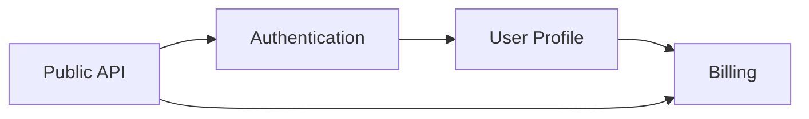
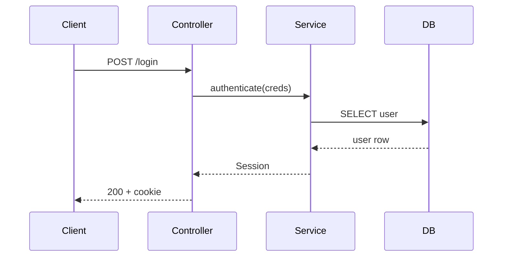
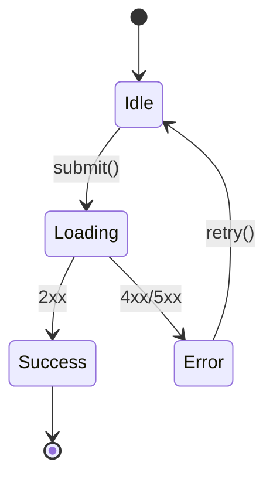
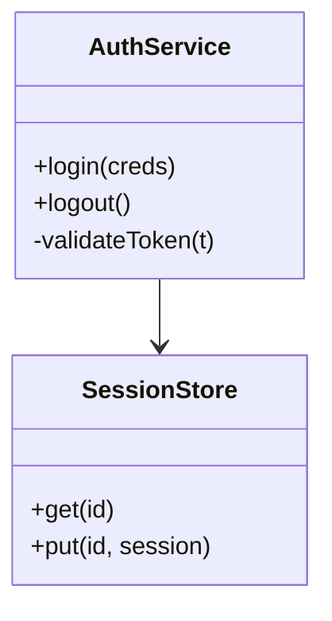

# Mermaid-Snippets

Bewährte Mermaid-Patterns für Blueprints. Nur nutzen, wenn ein Diagramm mehr zeigt als der umgebende Text.

## Dependency-Graph (für INDEX.md)

Einsatz: im `INDEX.md`. Pfeil = "benutzt".

## Sequenz-Diagramm (für Call-Flow)

Einsatz: wenn ein Feature mehr als drei aktive Teilnehmer hat. Unter "Datenfluss / Call-Flow".

## Zustands-Diagramm

Einsatz: nur wenn ein Feature echten State-Machine-Charakter hat (Formulare, Wizards, Connection-States).

## Klassen-/Modul-Diagramm (selten)

Einsatz: bei komplexen OOP-Schichtungen. In modernen JS/TS-Codebases meist overkill.

## Regeln für Diagramm-Einsatz

- **Kein Diagramm** bei ≤3 Teilnehmern oder linearen Flows: Text ist kürzer und klarer.
- **Mermaid bevorzugen**, weil es auf GitHub nativ rendert.
- **Namen aus dem Code übernehmen**, nicht neu erfinden, sonst divergieren Code und Doku.
- **Labels in der Doku-Sprache des Blueprints** (Standard: Deutsch).
- **Ein Diagramm pro Feature reicht**. Lieber einen guten Sequenz-Flow als drei halbgare Grafiken.
